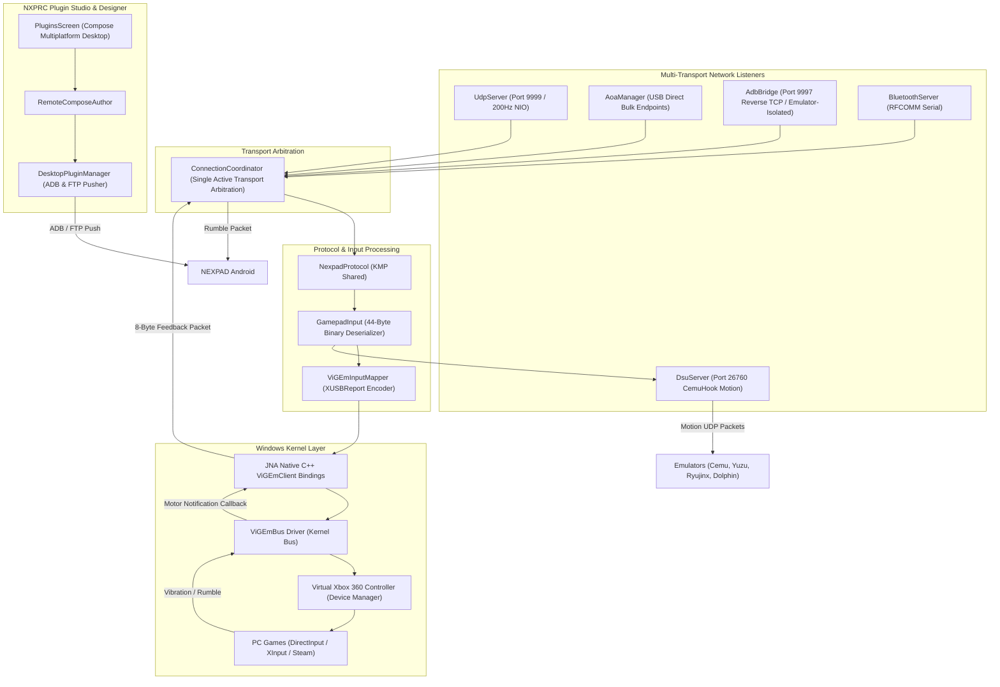

# 🏛️ NEXPAD Desktop Architecture

Deep technical design, kernel driver bindings, and networking pipelines of the **NEXPAD Desktop** server application.

```
                    ┌───────────────┐
                    │   README.md   │
                    │ "What is it?" │
                    └───────┬───────┘
                            │
            ┌───────────────┴───────────────┐
            ▼                               ▼
       HISTORY.md                    ARCHITECTURE.md
       "Where we                         "How it
       came from"                         works"
```

---

## 🏗️ High-Level System Architecture



---

## 🎮 Windows Kernel Driver Pipeline (`ViGEmBus`)

The core driver engine relies on **Java Native Access (JNA)** interfacing directly with the Windows C++ driver `ViGEmClient.dll`.

### 1. Virtual Controller Lifecycle
1. **Bus Allocation**: `vigem_alloc()` allocates the native driver client handle.
2. **Bus Connection**: `vigem_connect()` attaches to the `\Device\ViGEmBus` kernel device driver.
3. **Target Instantiation**: `vigem_target_x360_alloc()` creates a virtual Xbox 360 peripheral node.
4. **Target Registration**: `vigem_target_add()` plugs the virtual controller into Windows Plug-and-Play (PnP). Windows Device Manager immediately enumerates `Xbox 360 Controller for Windows`.

### 2. Fast Input Injection (`XUSBReport`)
Every incoming 44-byte binary packet from Android is converted into a native C `XUSB_REPORT` structure:

```cpp
typedef struct _XUSB_REPORT {
    USHORT wButtons;      // Bitmask of ABXY, DPad, Bumpers, Start, Back, Thumbs
    BYTE   bLeftTrigger;  // 0 - 255
    BYTE   bRightTrigger; // 0 - 255
    SHORT  sThumbLX;      // -32768 to 32767
    SHORT  sThumbLY;      // -32768 to 32767
    SHORT  sThumbRX;      // -32768 to 32767
    SHORT  sThumbRY;      // -32768 to 32767
} XUSB_REPORT;
```

The driver pushes this report via `vigem_target_x360_update()` in $< 0.1\,\text{ms}$.

### 3. Bidirectional Rumble Callbacks
When a PC game triggers haptic force feedback:
1. ViGEmBus fires a C native callback registered via `vigem_target_x360_register_notification()`.
2. The callback extracts `LargeMotor` ($0\dots 255$) and `SmallMotor` ($0\dots 255$) vibration levels.
3. The server serializes this into an 8-byte `PACKET_TYPE_FEEDBACK` packet and dispatches it over the active transport back to Android.

---

## 🌐 Server Networking & Transports

### 1. High-Speed UDP Server (`UdpServer.kt`)
* **Architecture**: Operates a non-blocking Java NIO `DatagramChannel` listening on UDP port `9999`.
* **Fixed 200 Hz Processing**: Polling and input handling operate at $5\,\text{ms}$ ticks to guarantee smooth, jitter-free input delivery.
* **Honest Telemetry**: Calculates real-time Round-Trip Time (RTT), packet transmission jitter, and effective delivery rates using microsecond timestamps.
* **Heartbeat & Watchdog**: Detects mobile disconnects after $3000\,\text{ms}$ of silence, automatically zeroing controller inputs to prevent games from executing stuck actions.

### 2. Universal Android Open Accessory 2.0 (`AoaManager.kt` & `UsbDeviceDetector.kt`)
* **Dynamic PnP Hardware Discovery**: Scans Windows Plug-and-Play hardware interfaces using SetupAPI / WMI to detect connected Android devices matching compatible ID `MS_COMP_MTP` and device class `WPD` across all Android OEMs without hardcoded vendor ID lists.
* **AOA Handshake**: Sends standard USB control transfers (`GET_PROTOCOL 51`, `SEND_STRING 52`, `START 53`) to transition the device into Android Accessory Mode (Google Accessory VID `0x18D1`, PID `0x2D00` / `0x2D01`).
* **Protocol Error Branching**:
  * `LIBUSB_ERROR_NOT_SUPPORTED (-12)`: Device is composite without WinUSB at root level; automatically triggers the elevated helper (`libwdi.dll`) to switch the root composite device to WinUSB.
  * `LIBUSB_ERROR_ACCESS (-3)`: Windows MTP/WPD driver holds an exclusive lock; scopes driver installation specifically to the MTP interface.
* **Bulk Endpoints**: Reads controller packets via USB Bulk IN endpoint and dispatches rumble feedback via USB Bulk OUT endpoint.

### 3. ADB Reverse Bridge (`AdbBridgeManager.kt`)
* **Zero-Configuration USB Fallback**: Executes `adb reverse tcp:9999 tcp:9999` and `adb reverse tcp:9997 tcp:9997` using the bundled platform-tools.
* **Emulator Isolation**: Automatically filters out Android Studio virtual devices (`emulator-*`), ensuring that active emulators never trigger `isAdbDevicePresent` or suppress physical USB accessories.

### 4. CemuHook DSU Motion Server (`DsuServer.kt`)
* **Motion Protocol**: Operates on UDP port `26760` adhering to the Cemuhook DSU protocol specification (`0x44 0x53 0x55 0x53` = `DSUS`).
* **Motion Stream**: Normalizes 6-axis gyroscope and accelerometer vectors from the mobile device and broadcasts them directly to emulators (Cemu, Yuzu, Ryujinx, Dolphin).

### 5. Single Active Transport Arbitration (`ConnectionCoordinator.kt`)
* Central coordinator manages transport switching between `USB_AOA`, `USB_ADB`, `WIFI`, and `BLUETOOTH`.
* Exactly one transport injects controller reports into the driver at any given time to eliminate conflicting input state and packet tearing.

---

## 🎨 NXPRC Plugin Studio & Designer

Desktop contains an integrated visual authoring environment for custom HUD controller packages:
* **`RemoteComposeAuthor`**: Generates binary `.nxprc` documents containing vector DOM nodes, CSS rules, and dynamic timeline tracks.
* **`DesktopPluginManager`**: Automatically detects connected Android phones via `adb devices` or local FTP and deploys packages with one click.
